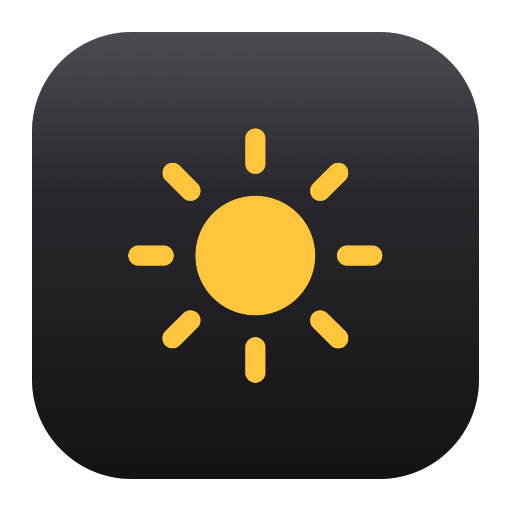

<div align="center">


# DimBar

**Brightness control for external monitors on Apple Silicon Macs — including clamshell mode.**


[English](#why) · [中文](#中文说明)

</div>

---

macOS only dims the built-in panel. Close the lid and drive an external monitor, and
F1/F2 stop doing anything at all — they target a display that is no longer there, so the
only way left to change brightness is the monitor's own OSD buttons.

DimBar fills that gap: it speaks **DDC/CI** to the monitor itself, which is the same
thing your OSD's physical buttons do. Lid shut, display asleep, Mac docked — it works.

## Why

| | |
|---|---|
| **Lid closed** | DimBar never touches the built-in display, so clamshell is just normal operation for it. |
| **No permissions** | No Accessibility, no Input Monitoring, no root, no kext. It talks I2C to the display, nothing else. |
| **Tiny** | ~200 KB app, single Swift binary, no dependencies, no Electron, no daemon. |
| **Stays in sync** | Re-detects displays on hot-plug, wake, and lid state changes. |

## Features

- Menu bar slider per external display
- Global shortcut `⌃⌥↑` / `⌃⌥↓` — 10% per press
- Works while the lid is closed, or when the display wakes from sleep
- Optional *Open at Login* (uses `SMAppService`, shows up in System Settings ▸ Login Items)
- Same binary doubles as a CLI for scripts, Alfred, Raycast, Hammerspoon…

## Install

### Download

Grab `DimBar-x.y.z.zip` from [Releases](../../releases), move `DimBar.app` to
`/Applications`, and launch it. A sun icon appears in the menu bar.

The app is **ad-hoc signed** (no paid Apple Developer ID), so on first launch macOS may
refuse to open it. Either right-click ▸ **Open**, or clear the quarantine flag:

```bash
xattr -dr com.apple.quarantine /Applications/DimBar.app
```

### Build from source

Requires macOS 13+ on Apple Silicon and Xcode command line tools.

```bash
git clone https://github.com/LIAB-BB/dimbar.git
cd dimbar
./build.sh --dist        # build/DimBar.app + build/DimBar-1.0.0.zip
open build/DimBar.app
```

## Usage

| Action | How |
|---|---|
| Set brightness | Click the menu bar icon, drag the slider |
| Brighter / dimmer | `⌃⌥↑` / `⌃⌥↓` |
| Multiple monitors | The shortcut targets the display under the mouse pointer |
| Start at login | Menu ▸ *Open at Login* |
| Quit | Menu ▸ *Quit DimBar* (`⌘Q`) |

### CLI

The same binary works headlessly:

```bash
DimBar list                 # displays + current brightness
DimBar get                  # just the percentage, for scripts
DimBar set all 30           # 30%
DimBar step all -10         # −10%
DimBar set 1 75             # first display only
DimBar login off            # disable autostart
```

## How it works

On Apple Silicon there is no public DDC API. macOS drives brightness over I2C through
`IOAVService`, a private interface in `IOKit`. DimBar resolves those symbols at runtime,
finds the `DCPAVServiceProxy` node belonging to each display, and sends DDC/CI
**VCP 0x10** (luminance) packets down that channel.

Two things were less obvious than expected, and both are worth knowing if you write
your own:

**1. The checksum has to cover the source address.** A DDC/CI packet is
`6E 51 82 01 <vcp> <checksum>`, and the checksum is the XOR of *everything* before it,
including the `0x51` source address. Several implementations leave `0x51` out. Lenient
monitors still answer; strict ones (a ViewSonic VX2478, for instance) stay silent and the
I2C read returns bus noise. DimBar sends the spec-compliant checksum first and falls back
to the other variant.

**2. Framebuffers and DDC proxies are not parent/child.** A display's
`IOMobileFramebuffer` and its `DCPAVServiceProxy` sit in different parts of the IORegistry,
so pairing them by iteration order breaks with two monitors. They do share a common
ancestor (the `dispextN` device), so DimBar matches on shared ancestry instead.

## Limitations

- **Apple Silicon only.** Intel Macs expose DDC through a different I2C path that this
  app does not implement.
- **DDC/CI must be enabled in the monitor's OSD.** It usually is; some models ship with it off.
- **`0%` is not off.** It is minimum backlight — the panel still glows. Use the monitor's
  power button for black.
- **Not for Sidecar, AirPlay or DisplayLink.** Those are virtual displays with no DDC channel.
- **Some docks don't pass DDC through.** If nothing responds, try connecting the display
  directly to the Mac.
- **Brightness can reset on its own.** Some monitors restore their own value after standby
  or an input switch, and macOS gives apps no hook to persist it across that.
- DDC is slow (\~20–50 ms per write) and varies by monitor. The app coalesces slider drags
  so the display never queues up stale values.

## 中文说明

macOS 只给内置屏做亮度控制。合盖接外接屏之后，F1/F2 找不到目标，只剩显示器 OSD 里
一格一格按——这个工具就是补这个缺口，直接走 DDC/CI 改显示器硬件亮度。

- 菜单栏太阳图标，点开是滑块；`⌃⌥↑` / `⌃⌥↓` 每次 10%
- **不需要任何权限**：不用辅助功能、不用输入监控、不用 root、不装内核扩展
- 合盖、休眠唤醒、拔插后自动重新识别
- 一个二进制同时是 CLI：`DimBar list` / `get` / `set all 30` / `step all -10`

从 [Releases](../../releases) 下载，或 `./build.sh --dist` 自己编译。首次打开如果被
Gatekeeper 拦，右键 ▸ 打开，或 `xattr -dr com.apple.quarantine /Applications/DimBar.app`。

注意：显示器 OSD 里要开着 DDC/CI；`0%` 不是断电，只是背光最低；仅支持 Apple Silicon。

## Credits

DDC/CI over `IOAVService` is Apple-private territory; the approach here follows the trail
blazed by [m1ddc](https://github.com/waydabber/m1ddc) and
[MonitorControl](https://github.com/MonitorControl/MonitorControl). If you want a
full-featured alternative with OSD, volume and contrast control, use MonitorControl — it
is excellent and also MIT licensed.

## License

MIT — see [LICENSE](LICENSE).
